<div align="center">

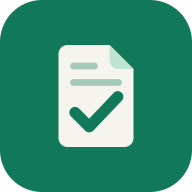

# LocalATSCV

### The resume that gets you the interview, ready in minutes.

**Free. No sign-up. No ads. Your data never leaves your browser.**

[**Build my resume →**](https://localatscv.mbonnici.fr/en) &nbsp;·&nbsp; [Check an existing resume](https://localatscv.mbonnici.fr/en/analyze) &nbsp;·&nbsp; [What's new](CHANGELOG.md)


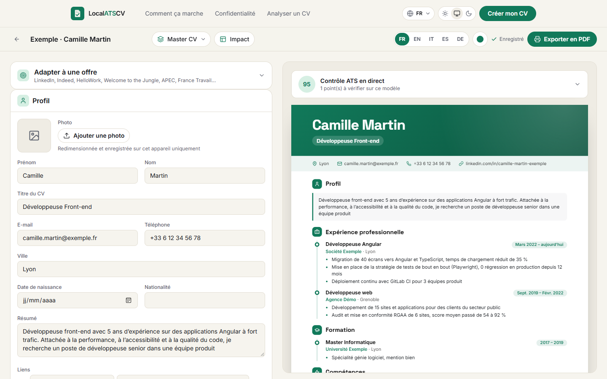

</div>

---

## Why LocalATSCV?

Most companies run every application through an **ATS** (applicant tracking system) before a human ever sees it. A beautiful resume built from free-floating design blocks can come out of that software as scrambled text, and quietly end up at the bottom of the pile.

Most online resume builders, on the other hand, want your email, your phone number, your whole career history on their servers, and then a subscription to download the PDF.

**LocalATSCV gives you both: designs that stand out to recruiters, and real text that robots read in the right order. Without an account, without a paywall, and without sending a single byte of your resume anywhere.**

|                                         | LocalATSCV | Typical online builder |
| --------------------------------------- | :--------: | :--------------------: |
| Free PDF download                       |     ✅     |      Often paid        |
| No account, no email                    |     ✅     |           ❌           |
| Resume stays on your device             |     ✅     |           ❌           |
| ATS check built into the editor         |     ✅     |         Rarely         |
| Tailor one master resume to every job   |     ✅     |         Rarely         |
| Works offline                           |     ✅     |           ❌           |
| Open source                             |     ✅     |           ❌           |

## Everything you need to land the job

### ✨ 30 templates that look great *and* pass the robots

23 graphic designs (Bento, Memphis, Bauhaus, Brutal, Duotone, Editorial, Prism, Nocturne, Sorbet, Origami, Hexa, Typo, Ribbon, Zen…) and 7 classic ones. Every single template prints real, selectable text, in reading order, with standard section titles.

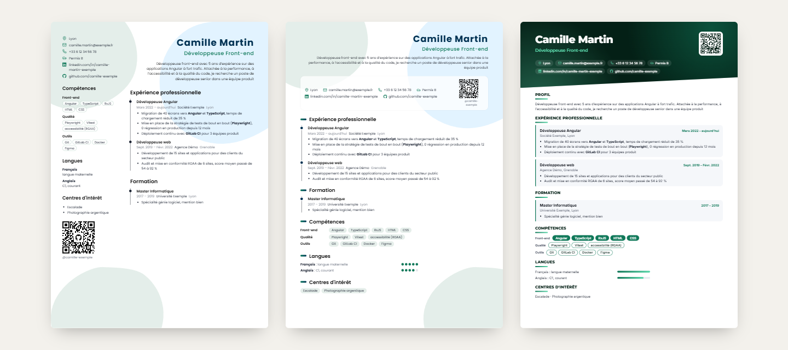

Make it yours with 16 accent colors (or any custom color), 15 fonts, link logos, a **QR code** to your portfolio or LinkedIn, and your driving licence.

### 🎯 One master resume, a tailored version for every job

Keep your whole career in a single **Master CV**, then compose a version for each application by ticking boxes. Nothing gets deleted, nothing gets lost.

Paste a job posting (LinkedIn, Indeed, HelloWork…) and LocalATSCV extracts its keywords, gives you a **match score**, adds the missing keywords in one click and generates the targeted version for you.

### 🤖 See your resume the way an ATS sees it

- **Live ATS check** right inside the editor
- **Resume analyzer** for any PDF, made with any tool: a score out of 100 with a published, explained scoring method, a list of fixes, and the raw text exactly as an ATS reads it
- Detects PDFs whose text is stored **out of order**, the classic trap of resumes made with free-form design tools
- **Weak phrase detector** suggesting strong action verbs, in the language of your resume

### ✉️ A matching cover letter

Each targeted version gets its own cover letter, in the exact same design as the resume.

### 📄 Fits on one page, one click

The **Fit to one page** button adjusts spacing, then text size, automatically (or by hand), and never leaves a heading orphaned at the bottom of a page.

### 📥 Start from what you already have

Import an existing resume (**PDF or Word .docx**), your **LinkedIn profile PDF** (desktop) or your **LinkedIn data archive** (mobile app). No retyping.

### 🌍 Made for every country

- Interface in **44 languages**, including 4 right-to-left, each with its own URL
- Resume content in English, French, Italian, Spanish or German
- In English, photo, date of birth and nationality are hidden automatically, as recruiters expect

### 💡 And all the small things that matter

Live A4 preview with page-break markers · drag and drop for sections, entries and bullets (keyboard accessible) · Undo / Redo everywhere (Ctrl+Z / Ctrl+Y) · guided language levels (A1 to C2, fluent, native…) · auto-save · JSON backup and restore · light and dark themes · installable app.

## A closer look

| Targeted version (Master CV)                                    | My resumes                                                 |
| --------------------------------------------------------------- | ---------------------------------------------------------- |
| 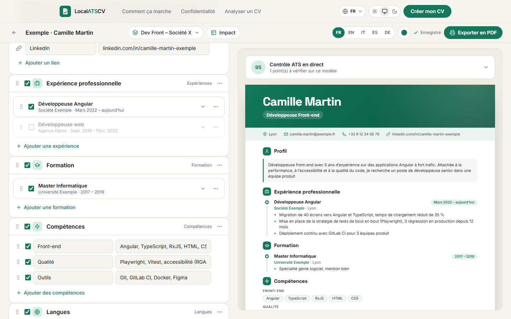        | 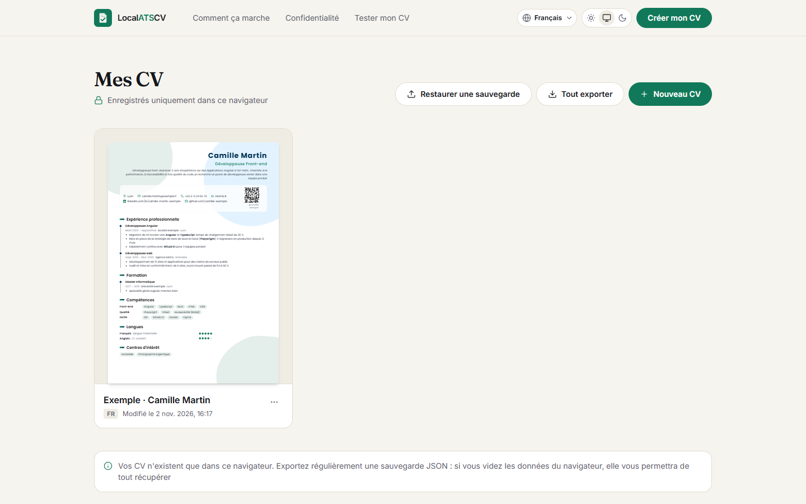               |
| **Cover letter**                                                | **Fit to one page**                                        |
| 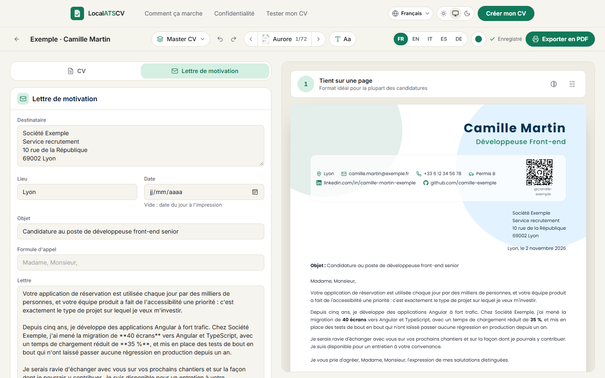                    | 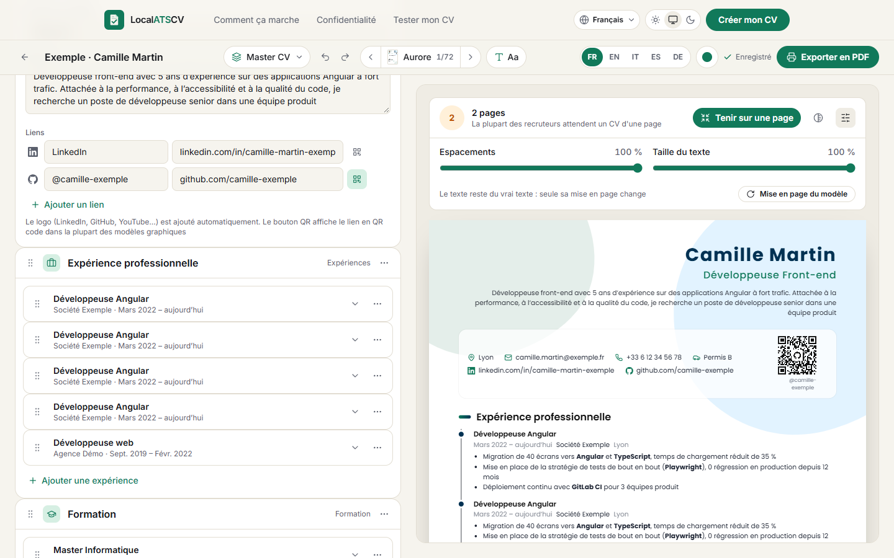          |
| **Tailor to a job posting**                                     | **LinkedIn import**                                        |
| 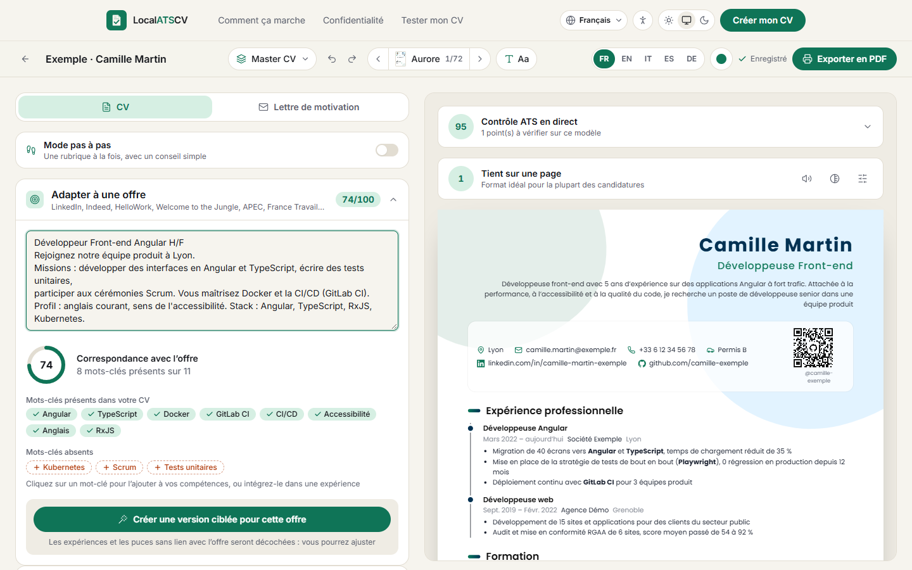      | 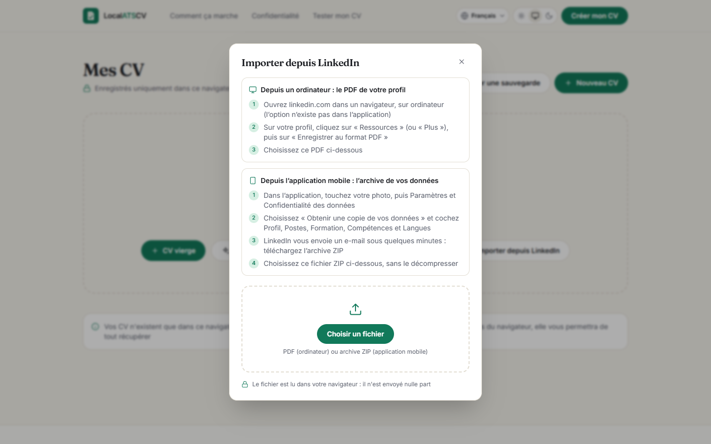   |
| **Template gallery**                                            | **Resume analyzer**                                        |
| 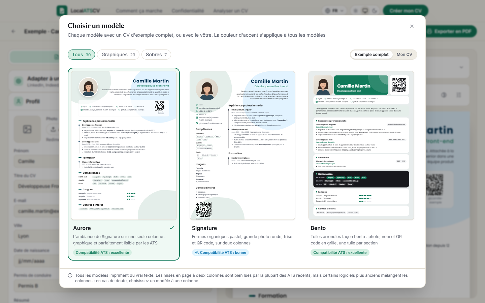             | 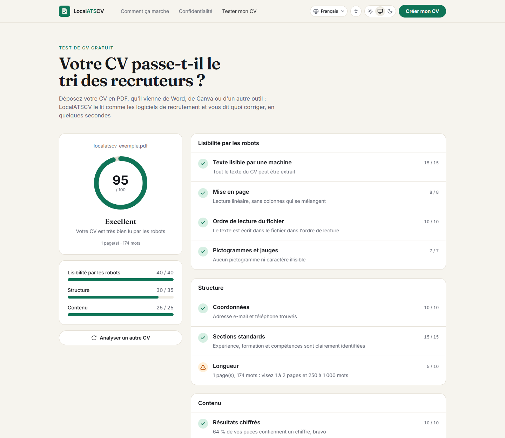           |
| **Dark theme**                                                  | **Home page**                                              |
| 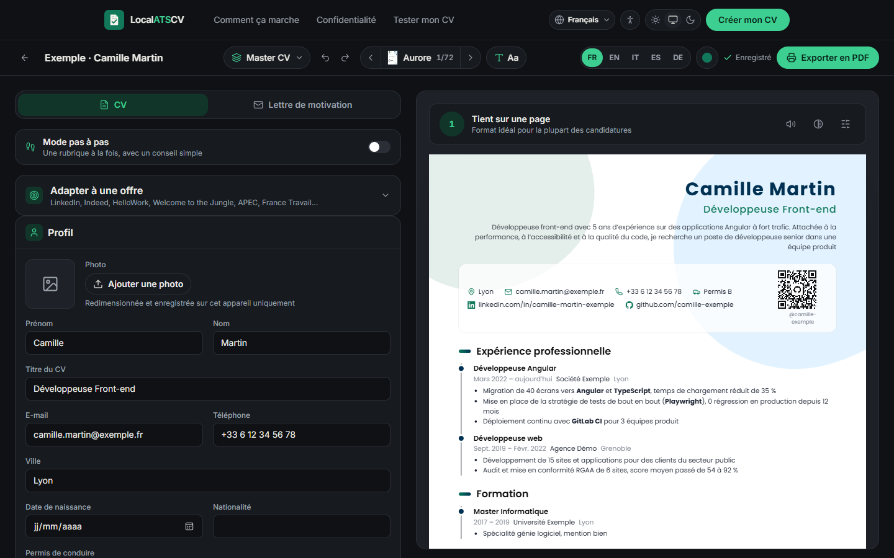       | 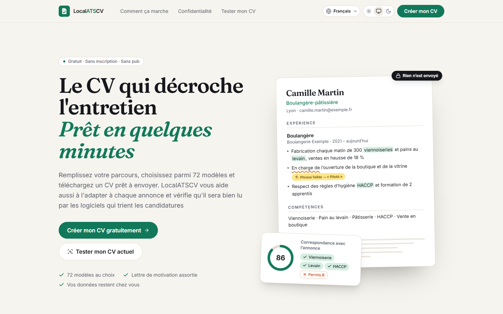           |
| **What an ATS reads**                                           | **Privacy**                                                |
| 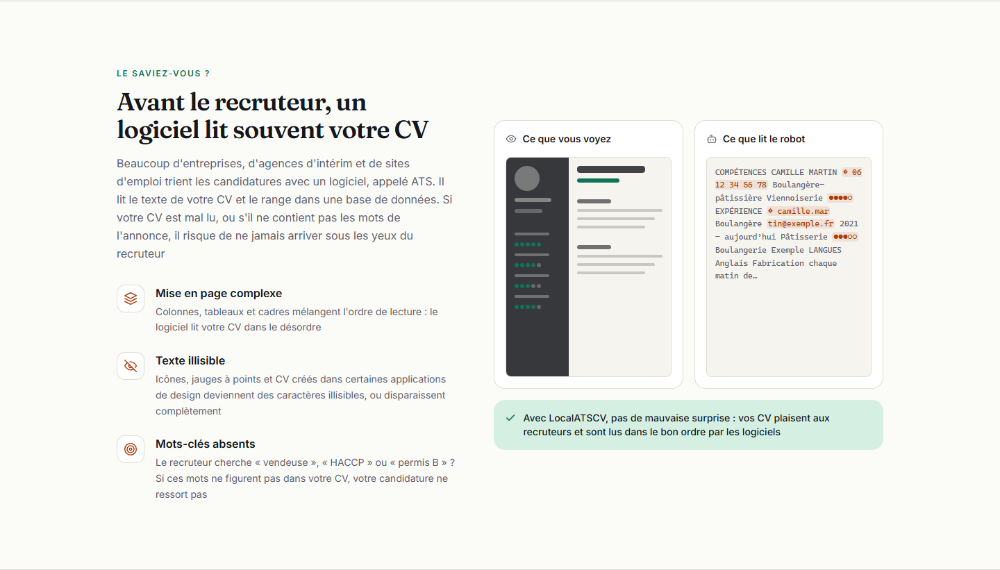          | 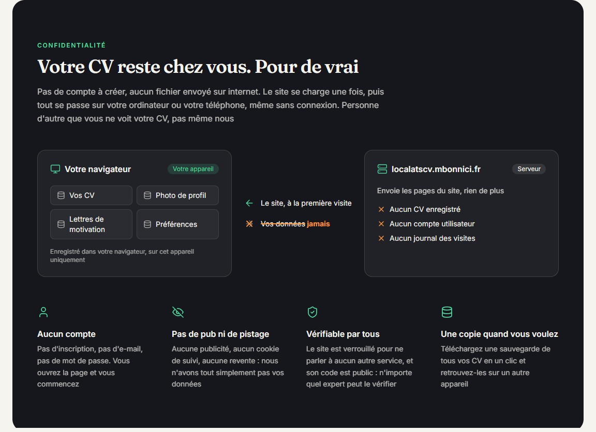                   |

<p align="center">
  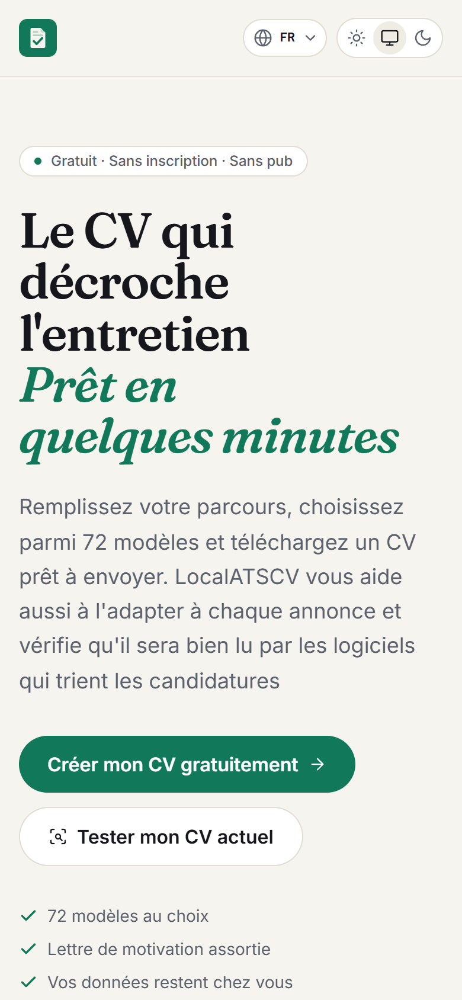
  &nbsp;&nbsp;
  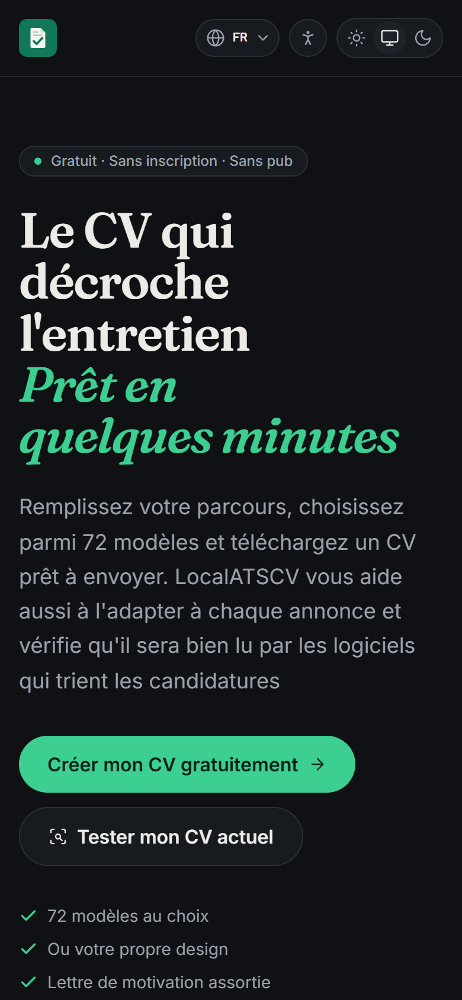
</p>

## 🔒 Private by design, and you can verify it

Privacy isn't a promise in a policy page, it's how the app is built:

- **No backend.** The server only hands out static files. Your resumes and photo live in your browser's IndexedDB, on your device.
- **Verifiable.** The Content Security Policy served by nginx forbids any connection to another domain (`connect-src 'self'`). Open your browser's network tab and see for yourself.
- **No tracking.** No access logs, no analytics, self-hosted fonts.
- **Works offline.** Installable PWA: after the first visit, everything works without a connection.
- **Open source** under the MIT license. Read every line.

---

## For developers

### Tech stack

- **Angular 22** (standalone, signals, zoneless), static build: public pages are pre-rendered at build time (SSG), the editor renders in the browser, no application server
- **Tailwind CSS 4**, fonts self-hosted through Fontsource (Inter, Fraunces, Poppins, Montserrat…)
- **Transloco** for the interface translations (44 languages)
- **Angular CDK** for accessible menus and drag and drop
- **Dexie** (IndexedDB) for local storage
- **pdf.js** to read PDFs (lazy-loaded), **fflate** for the LinkedIn archive, **uqr** for QR codes
- **Vitest** for unit tests
- **nginx** (Docker) to serve the files

### SEO and AI discoverability

Public pages are pre-rendered HTML with per-page meta tags, a link preview image, structured data (WebSite, WebPage, WebApplication, FAQ), a dated sitemap with hreflang, a `robots.txt` open to AI crawlers, `llms.txt` and `llms-full.txt`, and a Markdown version of every page (`index.md`, also served for `Accept: text/markdown` requests).

### Run it locally

```bash
npm install
npm start          # http://localhost:4200
npm run test:ci    # unit tests (including consistency checks on the 44 translation files)
npm run build      # production build (pre-rendered public pages) in dist/localatscv/browser
```

The service worker is only active in production builds.

### Docker

```bash
npm run docker:local   # build and start on http://localhost:8090
npm run docker:down    # stop
```

`docker-compose.yml` publishes no port (it is meant for Coolify); `docker-compose.local.yml` adds port 8090 for local testing.

### Self-host on Coolify

1. New resource → Git repository `ImMaxence/LocalATSCV`, build pack **Docker Compose**.
2. On the `web` service, set your domain (for example `https://localatscv.mbonnici.fr`). The container listens on port 80.
3. Deploy. Coolify handles the TLS certificate; the container exposes a healthcheck on `/healthz`.

### Screenshots

Regenerate the screenshots in `docs/screenshots` and the link preview image `public/og-image.png` with `npm run screenshots` (app running through `npm run docker:local`, Edge or Chrome installed).

### Versioning

The version shown in the app is read from `package.json`. Every release is described in [CHANGELOG.md](CHANGELOG.md).

## Contributing

Found a bug or have an idea? [Open an issue](https://github.com/ImMaxence/LocalATSCV/issues/new/choose): bug report and feature request templates are ready for you.

## License

[MIT](LICENSE) © Maxence Bonnici

<div align="center">

**[Create your resume now, for free →](https://localatscv.mbonnici.fr/en)**

</div>
